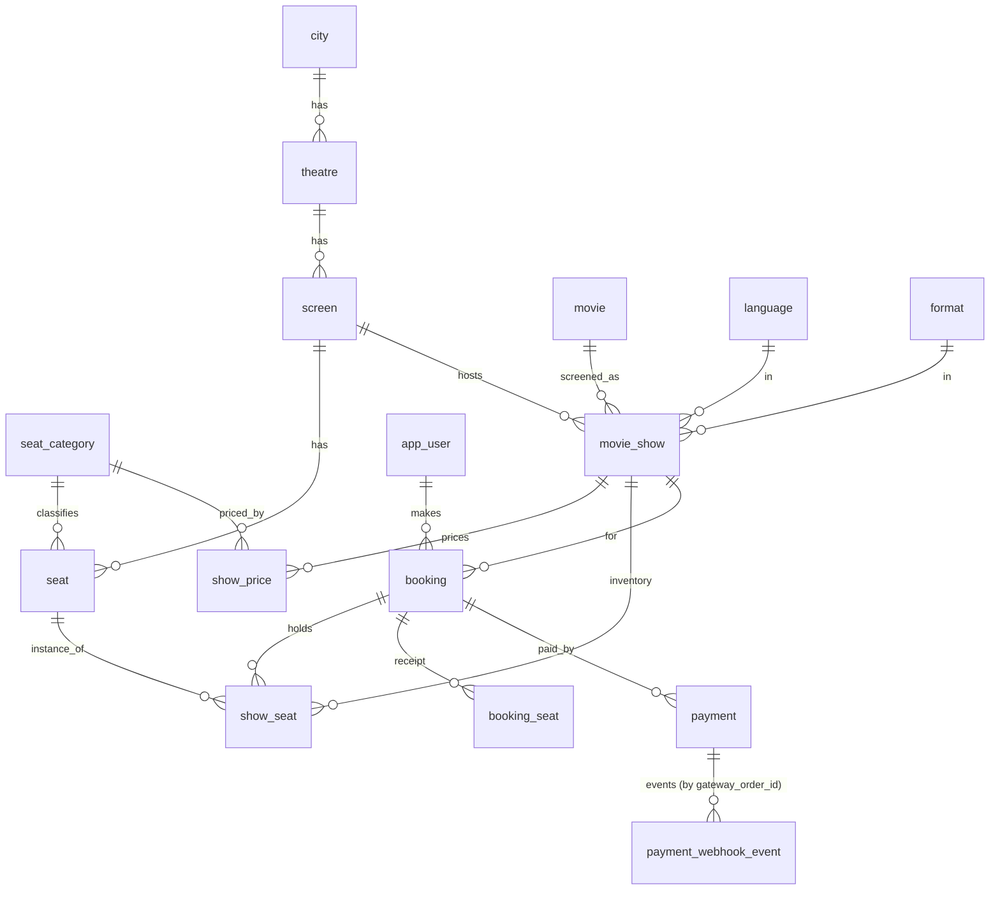

# Ticketing Backend: Schema, Locking Strategy, Show Listing

MySQL 8.0.16+ / InnoDB. Every script in `sql/` was run end-to-end on MySQL 8.0 and is directly executable.

| File | Purpose |
|---|---|
| `sql/01_schema.sql` | **P1**: `CREATE DATABASE` and all tables, keys, indexes, constraints |
| `sql/02_sample_data.sql` | **P1**: sample rows (dates are relative to `CURDATE()`, so P2 always returns data) |
| `sql/03_p2_queries.sql` | **P2**: shows at a theatre on a date, a per-movie grouped variant, and the 7-day date strip |
| `sql/04_concurrency_procedures.sql` | Seat hold, idempotent payment webhook, expiry sweeper |

Run in order: `mysql -uroot < sql/01_schema.sql` and so on. The shows table is named `movie_show` because `SHOW` is a reserved word in MySQL.

I could not see the reference screenshot (no image came through with the brief). The design follows the described flow: date picker, then per-movie showtimes at a theatre.

---

## 1. Entities and ER overview



## 2. Tables, attributes, and sample rows

PK = primary key, FK = foreign key, UQ = unique.

### city
| city_id PK | name | state |  UQ(name, state) |
|---|---|---|---|
| 1 | Bengaluru | Karnataka | |
| 2 | Mumbai | Maharashtra | |

### theatre
| theatre_id PK | city_id FK | name | address |  UQ(city_id, name) |
|---|---|---|---|---|
| 1 | 1 | PVR Orion Mall | Dr Rajkumar Rd, Rajajinagar, Bengaluru | |
| 2 | 1 | INOX Garuda Mall | Magrath Rd, Ashok Nagar, Bengaluru | |

### screen
| screen_id PK | theatre_id FK | name |  UQ(theatre_id, name) |
|---|---|---|---|
| 1 | 1 | Audi 1 | |
| 2 | 1 | Audi 2 | |

### seat_category
| category_id PK | name UQ |
|---|---|
| 1 | Classic |
| 2 | Prime |
| 3 | Recliner |

### seat (physical seats of a screen)
| seat_id PK | screen_id FK | row_label | seat_number | category_id FK |  UQ(screen_id, row_label, seat_number) |
|---|---|---|---|---|---|
| 7 | 1 | A | 1 | 2 | |
| 15 | 1 | A | 2 | 2 | |
| 23 | 1 | A | 3 | 2 | |

### movie
| movie_id PK | title | duration_min | certificate | release_date |
|---|---|---|---|---|
| 1 | Dune: Part Three | 165 | UA | 2026-10-01 |
| 2 | Kantara: Chapter 2 | 150 | UA | 2026-09-25 |

### language / format
| language_id PK | name UQ |  | format_id PK | name UQ |
|---|---|---|---|---|
| 1 | English | | 1 | 2D |
| 2 | Kannada | | 3 | IMAX 2D |

### movie_show
| show_id PK | screen_id FK | movie_id FK | language_id FK | format_id FK | start_time | status |
|---|---|---|---|---|---|---|
| 1 | 1 | 1 | 1 | 3 | 2026-10-14 10:00:00 | SCHEDULED |
| 2 | 1 | 1 | 1 | 3 | 2026-10-14 14:00:00 | SCHEDULED |
| 4 | 2 | 2 | 2 | 1 | 2026-10-14 11:15:00 | SCHEDULED |

UQ(screen_id, start_time) stops a screen being double-scheduled at the same instant and doubles as the P2 index.

### show_price
| show_id PK,FK | category_id PK,FK | price |
|---|---|---|
| 1 | 1 | 220.00 |
| 1 | 2 | 350.00 |
| 1 | 3 | 600.00 |

### app_user
| user_id PK | name | email UQ | phone UQ |
|---|---|---|---|
| 1 | Asha Rao | asha@example.com | +919800000001 |

### booking
| booking_id PK | user_id FK | show_id FK | status | hold_expires_at | created_at | version |
|---|---|---|---|---|---|---|
| 1 | 1 | 1 | CONFIRMED | 2026-10-14 11:26:31.054 | 2026-10-14 11:16:31.054 | 0 |

`status` is one of PENDING, CONFIRMED, EXPIRED, CANCELLED. `version` is the optimistic-lock counter.

### show_seat (live inventory, the lock target)
| show_id PK,FK | seat_id PK,FK | status | booking_id FK (NULL) | version |
|---|---|---|---|---|
| 1 | 7 | BOOKED | 1 | 1 |
| 1 | 8 | AVAILABLE | NULL | 0 |
| 1 | 15 | BOOKED | 1 | 1 |

`status` is one of AVAILABLE, HELD, BOOKED. A CHECK constraint enforces that AVAILABLE rows have no owner and HELD/BOOKED rows have one.

### booking_seat (immutable receipt)
| booking_id PK,FK | seat_id PK,FK | price_paid |
|---|---|---|
| 1 | 7 | 350.00 |
| 1 | 15 | 350.00 |

### payment
| payment_id PK | booking_id FK | gateway_order_id UQ | amount | status | created_at | updated_at |
|---|---|---|---|---|---|---|
| 1 | 1 | order_NX1001 | 700.00 | SUCCESS | 2026-10-14 11:16:31.054 | 2026-10-14 11:16:31.054 |

`status` is one of CREATED, SUCCESS, FAILED, REFUND_PENDING, REFUNDED.

### payment_webhook_event (idempotency ledger)
| event_id PK | gateway_order_id | event_type | payload (JSON) | received_at | processed_at |
|---|---|---|---|---|---|
| evt_001 | order_NX1001 | payment.success | {"order_id":"order_NX1001","amount":70000} | 2026-10-14 11:16:31.060 | 2026-10-14 11:16:31.060 |

---

## 3. Normalization

- **1NF**: all columns are atomic and every table has a primary key. There are no repeating groups. Seats of a booking are rows in `booking_seat`, not a CSV column. The only JSON column is the raw webhook payload, which is stored as an opaque audit blob and never queried relationally.
- **2NF**: no partial dependencies. Tables with composite keys are `show_price`, `show_seat`, and `booking_seat`. `price` depends on the whole `(show_id, category_id)`. `status`, `booking_id`, and `version` depend on the whole `(show_id, seat_id)`. `price_paid` depends on the whole `(booking_id, seat_id)`.
- **3NF**: no transitive dependencies. Price is not copied into `show_seat` (it comes from `show_price` via the seat's category). The show date is not stored separately from `start_time`. Total amount is not stored on `booking` (the amount charged lives on `payment`). Hold expiry lives only on `booking`, not on each seat.
- **BCNF**: every determinant is a candidate key. Each table's non-key columns are determined by its PK, and the alternate keys (`uq_screen_start`, `uq_seat_position`, `uq_gateway_order`, `email`, `phone`) are all declared UNIQUE and determine the same rows.

Two deliberate choices, stated openly:

1. `booking_seat.price_paid` is a historical snapshot of a fact (what was charged), not a derivable value. Re-deriving it from `show_price` would change old receipts if prices were edited.
2. `show_seat.status` is a small state column that could in principle be inferred from `booking.status`. It is kept because it is the hot row that gets locked, and the availability count (`WHERE show_id = ? AND status = ?`) needs to be an index-only read.

Cross-table consistency that SQL cannot express with plain keys: the seat in `show_seat` must belong to the show's screen. The seeding code enforces this, and a trigger or app-level check should be added if seats are ever inserted by other paths.

## 4. Locking strategy (no double booking, no lost holds)

**Layers**

1. **Redis fast gate (optional front door)**: `SET seat:{show}:{seat} {booking} NX EX 600` rejects most losers before they touch MySQL, and the TTL gives the timed hold. Redis is a performance layer only. **MySQL is the source of truth.**
2. **MySQL pessimistic row lock for claiming seats** (`sp_hold_seats`): `SELECT … FOR UPDATE` on the requested `show_seat` rows, in `seat_id` order, inside one transaction. A seat is claimable if it is `AVAILABLE`, or `HELD` with `hold_expires_at < NOW()`. The claim is all-or-nothing.
3. **PK as the hard backstop**: `(show_id, seat_id)` is the primary key and `booking_id` is a single column, so one seat can only ever have one owner.
4. **Optimistic `version` columns** on `booking` and `show_seat` for low-contention updates (cancel, edit). They are available to the application layer to detect lost updates.
5. **Idempotent webhooks**: the gateway's `event_id` is the primary key of `payment_webhook_event`. The first `INSERT IGNORE` wins and claims the event. Replays, including 20 simultaneous deliveries, return `DUPLICATE` and change nothing. The claim and the state change commit atomically in one transaction.

**Why pessimistic rather than optimistic for seat claims**: a popular show is a hot spot, with thousands of users targeting the same few rows. Optimistic locking would let all of them read, then all but one fail and retry, which causes retry storms. Pessimistic locking queues them briefly on the row and gives every loser a clean `UNAVAILABLE` after one lock wait. Optimistic locking remains the right tool for rarely contended rows such as a booking's own status.

**Timed holds**: `hold_expires_at` is authoritative. Expired holds are reclaimed in two ways: lazily, when the next buyer's `sp_hold_seats` takes the seat over, and eagerly, by `sp_release_expired_holds` (run every 5 s by `ev_release_expired_holds`, or from a worker). The webhook confirms a booking only if `hold_expires_at >= NOW()`, and it holds the booking row lock while doing so, so confirm and expire are mutually exclusive. A late payment becomes `REFUND_PENDING`, so a paying user can never steal a seat that has since been resold.

**Deadlocks**: all procedures lock `show_seat` rows in ascending `seat_id` order. The webhook locks payment, then booking, then `show_seat`. In the rare case where a lazy takeover races with a webhook for the same expired booking, InnoDB may pick a deadlock victim (error 1213). The procedures return `RETRY` and the caller simply retries.

## 5. P2: shows at a theatre on a date

```sql
SET @theatre_id = 1;
SET @show_date  = CURDATE();

SELECT  m.title                               AS movie,
        l.name                                AS language,
        f.name                                AS format,
        sc.name                               AS screen,
        s.show_id,
        TIME_FORMAT(s.start_time, '%h:%i %p') AS show_time
FROM    screen sc
JOIN    movie_show s ON s.screen_id   = sc.screen_id
JOIN    movie      m ON m.movie_id    = s.movie_id
JOIN    language   l ON l.language_id = s.language_id
JOIN    format     f ON f.format_id   = s.format_id
WHERE   sc.theatre_id = @theatre_id
  AND   s.start_time >= @show_date
  AND   s.start_time <  @show_date + INTERVAL 1 DAY
  AND   s.status = 'SCHEDULED'
ORDER BY m.title, l.name, f.name, s.start_time;
```

Output for theatre 1 on the sample date:

| movie | language | format | screen | show_id | show_time |
|---|---|---|---|---|---|
| Dune: Part Three | English | IMAX 2D | Audi 1 | 1 | 10:00 AM |
| Dune: Part Three | English | IMAX 2D | Audi 1 | 2 | 02:00 PM |
| Dune: Part Three | English | IMAX 2D | Audi 1 | 3 | 06:30 PM |
| Inside Out 3 | English | 3D | Audi 2 | 6 | 08:00 PM |
| Kantara: Chapter 2 | Kannada | 2D | Audi 2 | 4 | 11:15 AM |
| Kantara: Chapter 2 | Kannada | 2D | Audi 2 | 5 | 03:00 PM |

Why it is fast: the date is a half-open range on a raw `start_time` column (never `DATE(start_time) = …`, which would defeat the index), and `uq_screen_start (screen_id, start_time)` serves the filter. `03_p2_queries.sql` also has a variant that groups timings per movie as a JSON array, matching the screenshot's layout, and the recursive CTE that generates the 7-day date strip.

A note on late-night shows: a 12:30 AM show falls on the next calendar day by this query. If the business wants it listed under the previous day, shift the window to something like 04:00 to 04:00.

## 6. Verification run

Against MySQL 8.0 on the sample data:

| Test | Result |
|---|---|
| 30 concurrent sessions request the same 2 seats | exactly **1 HELD**, 29 UNAVAILABLE; 2 seats HELD, 1 booking created |
| Same `payment.success` webhook delivered 20 times concurrently | **1 CONFIRMED**, 19 DUPLICATE; seats BOOKED once; 1 event row |
| Hold expires (1 s), second user requests the same seat | takeover succeeds; old booking becomes EXPIRED |
| `payment.success` arrives for the expired booking | booking stays EXPIRED, payment becomes **REFUND_PENDING** |

These were quick shell-level checks. The full load test (thousands of concurrent users, burst queue, throughput and latency percentiles) is a follow-on item, for example k6 or Locust running the three procedures above, asserting that `COUNT(*) FROM show_seat WHERE status<>'AVAILABLE'` equals the number of successful holds and that no seat appears under two live bookings.